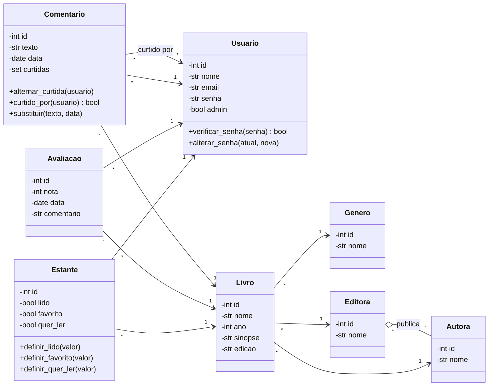
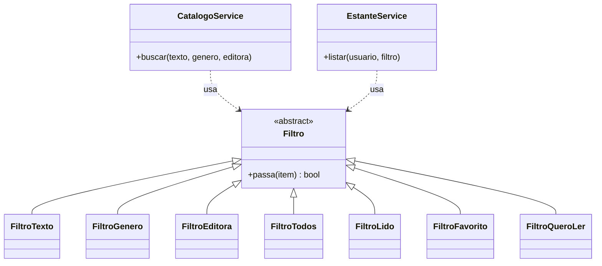
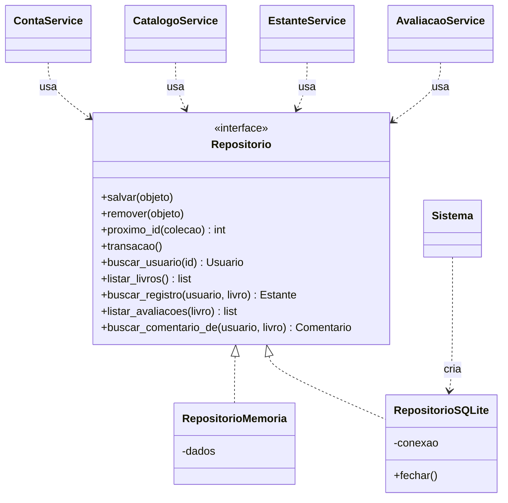
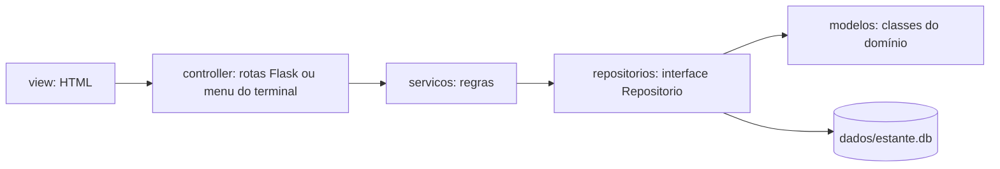

# Diagrama de classes

Abra no GitHub, no VS Code com a extensão Mermaid ou em mermaid.live.

Leitura rápida das setas:

| Seta | Significa | Exemplo daqui |
|---|---|---|
| `-->` associação, com navegabilidade | A classe da ponta sem seta guarda a outra | `Estante` guarda o `Usuario` e o `Livro` |
| `o--` agregação | Tem um, e a parte sobrevive sem o todo | `Editora` tem `Autora`; apagar a editora não apaga a autora |
| `*` e `1` | Multiplicidade | Muitos livros para um gênero |

`Estante` é a classe que resolve "lido, favorito e quero ler são de cada pessoa": uma linha por par usuário e livro.

# Padrão Strategy (filtros)

`<|--` é herança (aqui, realização de uma classe abstrata) e `..>` é dependência: o serviço só usa o filtro durante a chamada, não o guarda.

# DAO (repositórios)

`<|..` é realização: a classe cumpre o contrato da interface. Os serviços dependem só de `Repositorio`, então trocar a implementação não muda os serviços. Os testes usam as duas implementações.

# Camadas

